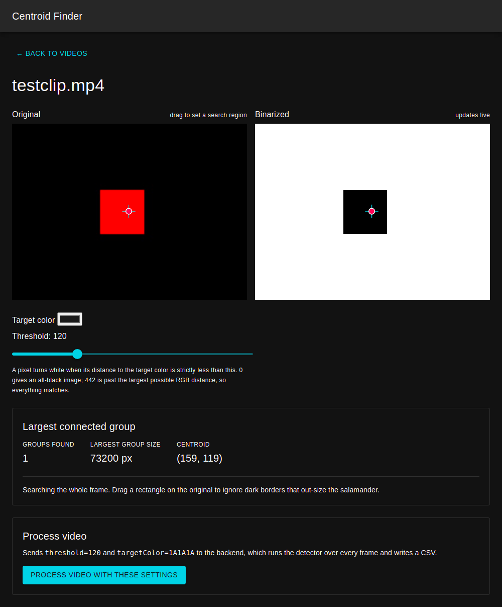
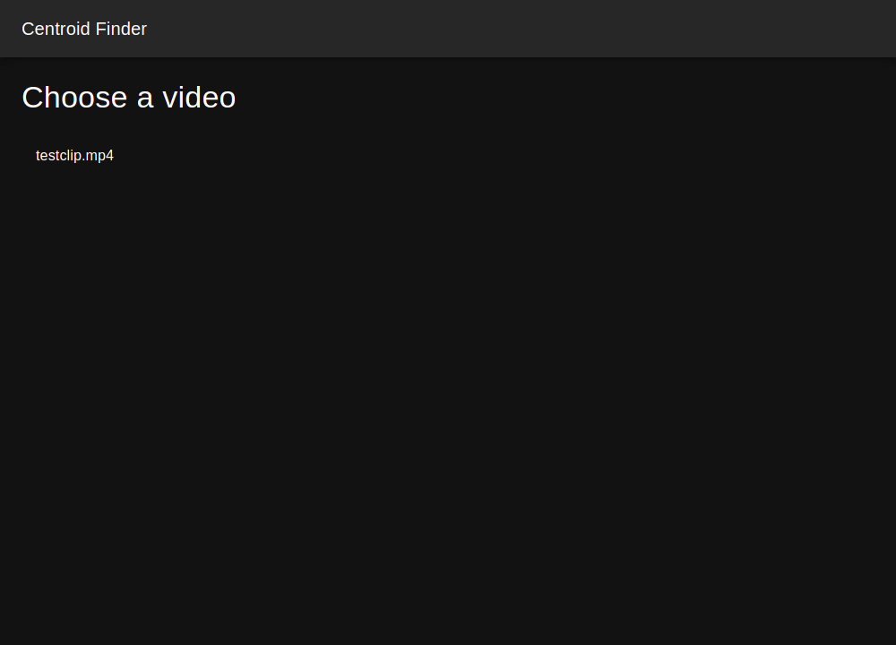
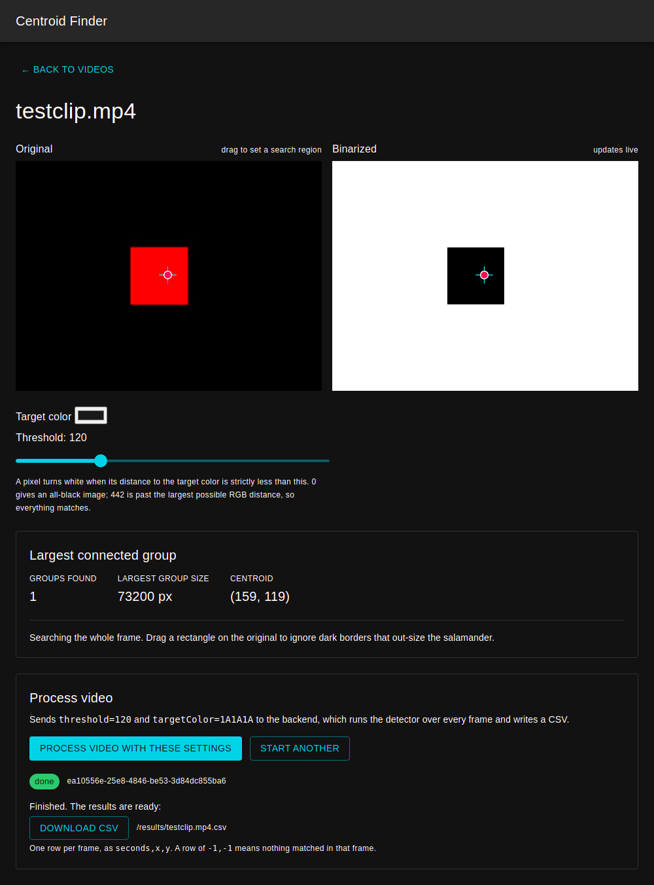
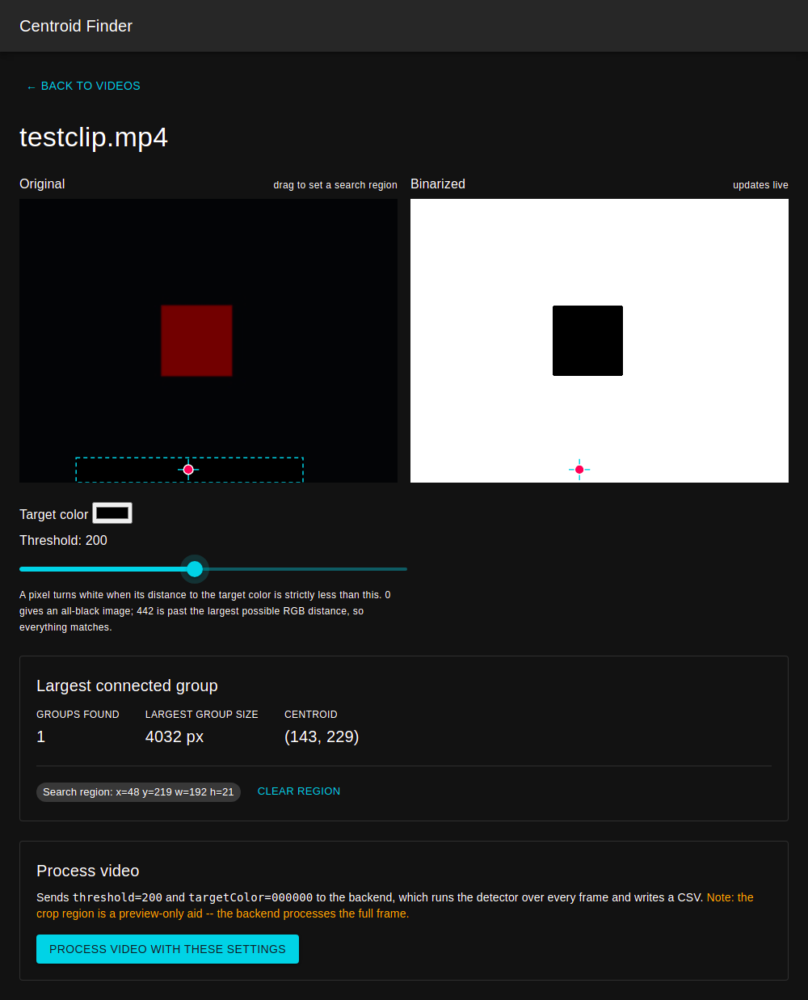

# Centroid Finder — Frontend

A React frontend for the [centroid-finder](https://github.com/Jaronie/centroid-finder)
salamander-detection backend. Browse the available videos, tune the detector
against a real frame until the dot lands on the salamander, then hand those
settings to the backend to process the whole clip into a CSV.



---

## Setup

### 1. Start the backend

The frontend talks to the Spring Boot server, which listens on **port 8081**
(8080 is taken by Apache on the dev machine):

```bash
cd centroidFinder/server
mvn spring-boot:run
```

It needs `ffmpeg` on the PATH and the processor jar built:

```bash
cd centroidFinder/processor
mvn package -Djavacpp.platform=linux-x86_64
```

Drop videos into `server/data/videos/` — they show up in the chooser.

### 2. Start the frontend

```bash
npm install
npm run dev
```

Open <http://localhost:5173>.

Requests to `/api`, `/thumbnail`, `/process`, `/results` and `/videos/<file>`
are proxied to `localhost:8081` by the Vite dev server, so the browser only
ever talks to one origin and **the backend needs no CORS configuration**.

### Running without a backend

If the server is down, start with mock data instead:

```bash
VITE_USE_MOCKS=true npm run dev
```

`api.js` then serves a canned video list and draws a synthetic thumbnail (a
dark frame with a red circle and a green square) so colour matching can still
be exercised. Mock mode is a development fallback only — the real API is the
default path.

---

## Scripts

| Command | What it does |
| --- | --- |
| `npm run dev` | Dev server with hot reload and the backend proxy |
| `npm run build` | Production build into `dist/` |
| `npm run lint` | ESLint |
| `npm test` | Mocha unit tests for the detection algorithm |
| `npm run test:e2e` | Cypress end-to-end tests (needs `npm run dev` running) |
| `npm run cypress:open` | Cypress interactive runner |

---

## Routes

| Route | Page |
| --- | --- |
| `/videos` | Video Chooser — lists what the backend has |
| `/preview/:filename` | Preview, live tuning, and job submission |
| `/` | Redirects to `/videos` |

---

## How it works

### Choosing a video



`GET /api/videos` returns a plain JSON array of filenames. Each one links to
`/preview/<filename>`; the filename lives in the URL, so a preview page can be
reloaded or shared. Loading and error states are handled by the `withStatus`
higher-order component, which wraps the list and renders a spinner or an alert
in its place.

### Live tuning

`GET /thumbnail/<filename>` returns the first frame as JPEG. The frame is drawn
to an offscreen canvas so its pixels can be read, and then every change to the
threshold or target color re-runs the full detection pipeline in the browser:

```
thumbnail JPEG
  ->  -> offscreen canvas -> ImageData
  -> binarizePixels: Euclidean RGB distance to target color, < threshold ? white : black
  -> DFS connected groups (4-way, no diagonals)
  -> sort descending by size, then centroid x, then y
  -> largest group's centroid -> the dot
```

The work is scheduled in a `requestAnimationFrame` so dragging the slider
coalesces into one run per frame instead of one per event. At 320×240 that is
well inside a frame's budget, so the preview tracks the slider in real time.

### Processing the video



"Process Video with These Settings" sends
`POST /process/<filename>?targetColor=<hex>&threshold=<int>`, which answers
`202 Accepted` with a job id. The app then polls
`GET /process/<jobId>/status` once a second until it reports `done` (with the
CSV path) or `error`. Polling stops as soon as the job settles or the page
unmounts.

The CSV has one row per frame, `seconds,x,y`, with `-1,-1` where nothing
matched.

> **`targetColor` must be bare six-digit hex with no leading `#`.** The backend
> rejects a `#` with a 400 because the processor calls `Integer.parseInt(hex, 16)`.
> `<input type="color">` always produces `#rrggbb`, so `startJob` strips it in
> one place where no caller can forget.

---

## Unique feature: crop / region-of-interest



Drag a rectangle on the original frame to restrict the search to that region.

This exists because "largest connected group" only finds the salamander when
the salamander really *is* the largest matching blob. A dark border, letterbox
bars, or a shadowed strip at the top of the frame can easily out-size it — the
screenshots above show exactly that: at a near-black target the biggest group is
the 73,200-pixel background, not the subject.

It is the UI for the backend's `CroppingImageGroupFinder`, and it mirrors the
processor's `--crop=X,Y,W,H` / `--inset=N` flags. Centroids are translated back
into full-frame coordinates, so the numbers on screen always refer to the whole
frame, never to the region.

The region is a **preview-only tuning aid** — the current API takes no crop
parameter, so a submitted job still processes the full frame. The app says so
next to the button rather than quietly implying otherwise.

---

## The algorithm

Step 3 of the assignment requires reimplementing the Java detection logic
exactly in JavaScript. Each Java class has a counterpart in `src/utils/`:

| Java | JavaScript |
| --- | --- |
| `EuclideanColorDistance` | `euclideanColorDistance.js` |
| `DistanceImageBinarizer` | `binarize.js` (fast path) / `distanceImageBinarizer.js` (literal translation) |
| `DfsBinaryGroupFinder` | `dfsBinaryGroupFinder.js` |
| `Group` / `Coordinate` | `group.js` |
| `CroppingImageGroupFinder` | `croppingImageGroupFinder.js` |
| `BinarizingImageGroupFinder` | `pipeline.js` |

There are two binarizers on purpose. `binarize.js` is the one the app runs: a
single pass over a typed array that compares squared distances to avoid a sqrt
per pixel. `distanceImageBinarizer.js` is the line-by-line translation of the
Java, kept as the reference. A unit test runs both over a random image across
many colors and thresholds and asserts they agree on every pixel, which is what
keeps the optimized version honest.

Details that must match, and do:

- **Strictly less than.** A pixel is white when `distance < threshold`, not
  `<=`. A threshold of 0 yields an all-black image even where a pixel matches
  the target exactly.
- **Integer division** for centroids (`Math.trunc`, matching Java's `int / int`).
- **4-way connectivity** — pixels touching only at a corner are separate groups.
- **Descending sort** by size, then centroid x, then centroid y.
- **Iterative DFS** with an explicit stack, so a large solid region cannot
  overflow the call stack.
- `& 0xFFFFFF` to drop the alpha byte before comparing colors.

### Verified against the Java backend

The port was checked against real output rather than assumed correct. The
backend processed `testclip.mp4` and wrote its CSV; the same frame 0 was then
run through the JavaScript:

| Settings | Java CSV (frame 0) | JavaScript |
| --- | --- | --- |
| `targetColor=1A1A1A threshold=120` | `0.000,159,119` | `(159, 119)`, 73200 px |
| `targetColor=8B4513 threshold=90` | `0.000,-1,-1` | no match |

Identical, both from the raw video frame and from the JPEG thumbnail the
browser actually sees.

---

## Testing

**Mocha — 64 unit tests** over the algorithm, mirroring the backend's JUnit
suites (`EuclideanColorDistanceTests`, `DfsBinaryGroupFinderTests`,
`DistanceImageBinarizerTest`, `CroppingImageGroupFinderTests`) case for case,
including the error types, the integer-division centroid, the strict `<`
boundary, and diagonal non-connectivity — plus the agreement tests between the
two binarizers.

```bash
npm test
```

**Cypress — 11 end-to-end tests** covering both routes: the video list and its
failure state, navigation, the side-by-side frames, live recomputation as the
threshold and color change, the crop region, and the full job lifecycle
(submit → poll → CSV link), plus server-reported 400 and job errors. Backend
calls are stubbed with `cy.intercept` using the exact real response shapes, so
the suite is deterministic and runs without the Java server.

```bash
npm run dev          # in one terminal
npm run test:e2e     # in another
```

`cypress/e2e-shots/` holds a separate spec that drives the app against the
**real** backend to regenerate the screenshots in this README.

### If Cypress will not start

Running inside VS Code's integrated terminal can set `ELECTRON_RUN_AS_NODE=1`,
which makes Cypress's Electron binary behave as plain Node and fail with
`bad option: --no-sandbox`. Unset it for the run:

```bash
env -u ELECTRON_RUN_AS_NODE npx cypress run
```

---

## Project layout

```
src/
  api.js                     every HTTP call, and the mock switch
  App.jsx                    routes
  main.jsx                   MUI theme + router
  hocs/withStatus.jsx        loading/error wrapper
  utils/
    binarize.js              binarization (the fast path the app runs)
    euclideanColorDistance.js
    distanceImageBinarizer.js  literal Java translation, the reference
    dfsBinaryGroupFinder.js  connected groups
    group.js                 Group / Coordinate
    croppingImageGroupFinder.js
    pipeline.js              binarize -> group -> largest
  hooks/useJob.js            submit + poll to completion
  components/
    FrameOverlay.jsx         crop drag + centroid overlay
    CentroidMarker.jsx       the dot
    JobPanel.jsx             submit, progress, CSV link
  pages/
    VideoChooser.jsx         /videos
    Preview.jsx              /preview/:filename
test/                        Mocha unit tests
cypress/e2e/                 Cypress end-to-end tests
```

`src/utils/` imports nothing from React, which is what lets the same code run in
the browser and under Mocha in Node.

---

## Notes for the team

- **`/videos` is both a frontend route and a backend static path.** The Vite
  proxy entry is the regex `^/videos/.+`, so `/videos/clip.mp4` (a file) is
  forwarded while `/videos` (the page) stays with React Router. A plain
  `/videos` proxy entry makes the chooser page 404.
- **Proxy keys must start with `/`.** Vite matches them against the request
  path, so a key of `api` never matches `/api/videos`.
- **MUI v6+ removed the system props.** `justifyContent`, `alignItems` and
  `flexWrap` are silently ignored when passed directly to `Stack`; they have to
  go through `sx`.
- Job state lives in memory on the server, so restarting it makes in-flight job
  ids return 404. The app surfaces that message rather than polling forever.
